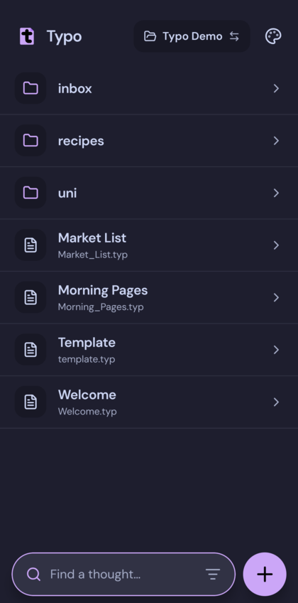
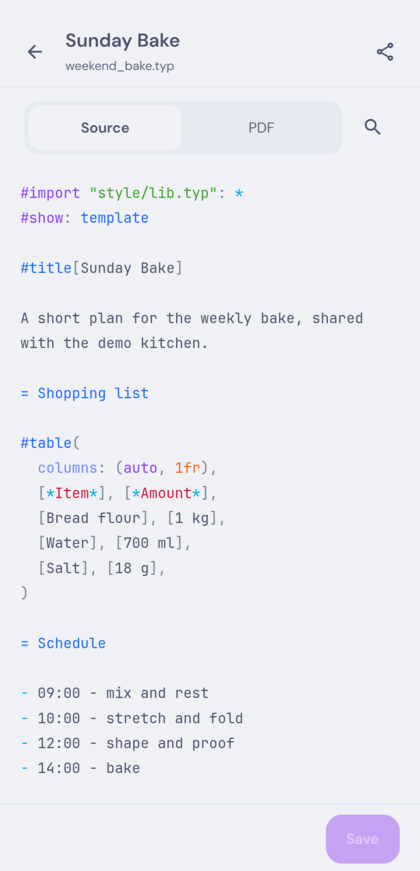
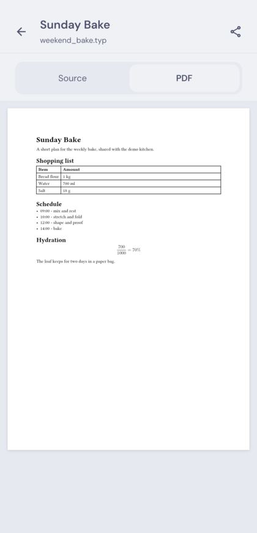
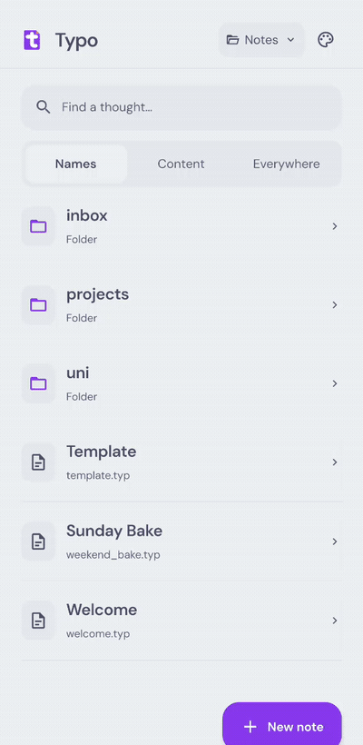
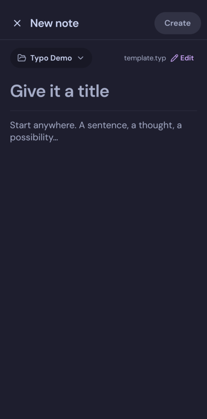
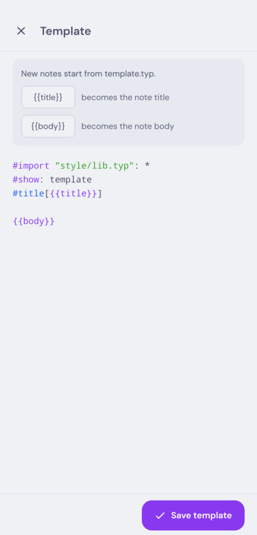

# Typo

Typo is an Android app for [Typst](https://typst.app) notes in a plain folder.
Open the folder, search your notes, write, and take the compiled PDF with you.
Your `.typ` files are the source of truth. There is no account, server, or
app-specific sync layer.

  
  
  

## Install

Typo is distributed as an APK from GitHub releases.

### Obtainium (recommended)

[Obtainium](https://github.com/ImranR98/Obtainium) installs apps from their
release pages and updates them for you.

1. Install Obtainium from
   [F-Droid](https://f-droid.org/packages/dev.imranr.obtainium.fdroid/) or its
   [releases page](https://github.com/ImranR98/Obtainium/releases).
2. Tap **Add App** and paste `https://github.com/DontBlameMeDev/typo`.
3. Tap **Add**. Obtainium finds the APK in each release and offers updates when
   one is published.

### Manual install

Download `typo-<version>.apk` from the
[latest release](https://github.com/DontBlameMeDev/typo/releases/latest) and
open it. Android may ask you to allow installs from your browser or file
manager.

Typo needs Android 7.0 or newer and a 64-bit ARM phone.

## Set up your vault

1. Keep your notes in a folder on your phone. To use them on more than one
   device, sync that folder with [Syncthing](https://syncthing.net) or another
   file sync tool.
2. Open Typo and choose the folder with Android's folder picker.
3. Typo remembers the folder and opens your notes on later launches.

If you sync the folder, choose the copy Syncthing writes to, not an imported
copy. Typo can open internal storage and SD-card folders through Android's
picker. Cloud and third-party document providers are not supported.

## What you can do

  

- Browse folders, open nested notes, and search names, content, or everywhere
  with fuzzy matching.
- Edit `.typ` files offline with Typst syntax highlighting. Basic notes compile
  with bundled fonts.
- Compile, view, and share PDFs with continuous scrolling, pinch zoom, and
  panning. Double tap to return to fit width.
- Share Typst source, including the current unsaved buffer.
- Swipe a note or folder left to move it to `.trash`, or right to favorite it.
  The action fires when the swipe goes far enough, with a short haptic tap at
  the threshold, and a shorter swipe springs back.
- Favorites show a star and sort above everything else in the folder where they
  appear.
- Long-press a note or folder to move it, and create a new folder inside any
  existing folder while moving.
- Create notes from `template.typ`, and edit it from the New note screen or the
  Template note.
- Use Catppuccin Latte, Frappe, Macchiato, or Mocha, any accent color, system
  appearance, and AMOLED black.
- Detect changes made outside Typo before saving instead of overwriting them.

  
  

New notes start from `template.typ` in the vault root. If it does not exist,
Typo uses a default template and saving creates the file. Open the Template
note, or use Edit on the New note screen, to change it. Use `{{title}}` and
`{{body}}` where the note title and text belong.

## Privacy

Notes stay on the device. Typo only connects to `packages.typst.org` to fetch
missing public packages. If you sync the vault, Syncthing or the file sync tool
you choose handles it.

## License

GPL-3.0. See [LICENSE](LICENSE).
